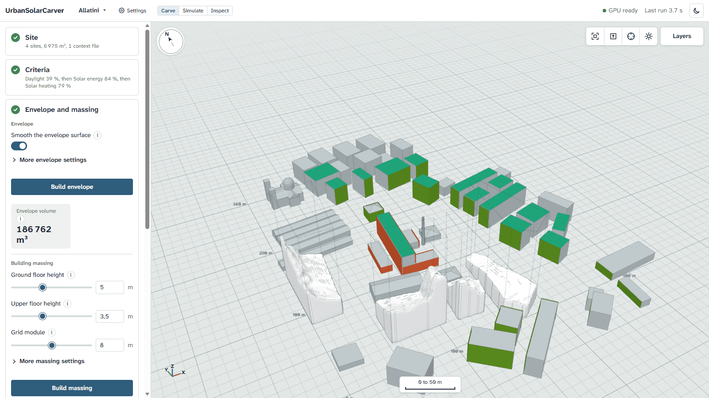
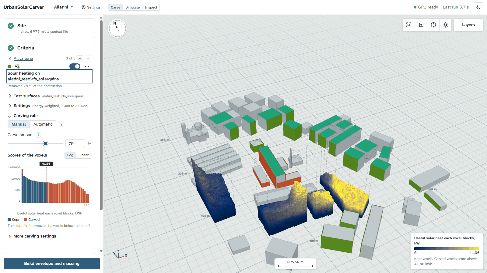

# Urban Solar Carver

[](LICENSE)
[](https://doi.org/10.5281/zenodo.19443737)
[](https://doi.org/10.1007/978-3-032-34930-9_70)

**How much more can be built here without harming the neighbours?**

Urban Solar Carver is an app that finds the maximum developable volume on a site that keeps the environmental performance of
its urban context: the sun on the neighbours' windows, the daylight in their rooms, the solar energy on their roofs.



*Allatini, Thessaloniki: the carved envelope (white) on four plots, inside the outline of the volume allowed (dotted). It keeps
the daylight on the neighbours' windows (red), the solar energy on their roofs (teal) and the winter sun on their facades
(green), three criteria applied one after the other.*

It is made for urban designers, planners, architects and decision makers. It runs in your browser, on your own computer: bring
in the site and its neighbours, choose what to protect, and see the largest building that respects it, with its floor plates
and floor areas. It uses an NVIDIA graphics card when there is one, and the processor otherwise.

## What it protects

| Mode | What it keeps |
|---|---|
| **Sun hours** | The hours of direct sun on windows, facades or open spaces, on the dates and hours you choose |
| **Daylight** | The overcast sky that lights the rooms behind the windows |
| **Solar heating** | The sun of the hours when it cuts heating (passive solar), from the site's weather |
| **Solar energy** | The solar energy reaching roofs and facades, for photovoltaics or solar collectors |
| **Angle rule** | A fixed angle from each surface, as many regulations set it; no weather file needed |
| **Night cooling** | The night sky that lets surfaces cool by radiation (experimental) |

More are planned, such as outdoor thermal comfort. Several criteria can be combined on one project, each on its own surfaces.

## How it works

1. **The site.** The largest building you would allow, as a volume or as sites drawn with their heights, and the neighbours
   around it, imported or drawn as blocks.
2. **What to protect.** Windows, facades, roofs or open spaces: imported, drawn on the ground, or picked on the neighbours.
3. **Carve.** The app scores every part of the volume by how much it takes from the protected surfaces, using the sun and sky
   of the site's weather file. A slider sets how much to carve, against those scores.
4. **The result.** The carved envelope and its building massing, ready to export.


*Carving more for solar heating keeps more winter sun on the neighbouring facades and leaves less volume.*

| Carve | Simulate | Building massing |
|---|---|---|
|  |  |  |
| How much each part of the volume blocks, the histogram and the slider | Sun hours on 21 December, and how much of the no-build value is kept | Floor plates that follow the envelope, with floor areas |

**Inspect** checks the input files before a run: which way each surface faces, and which surfaces a run would leave out.

## Install (Windows)

1. **Code > Download ZIP** on this page, and unzip the whole zip into `%LOCALAPPDATA%\Programs\UrbanSolarCarver` (not a
   OneDrive folder).
2. Double-click `setup-urbansolarcarver.bat`. It downloads Python and the packages into the folder, checking each file against
   a hash already in the folder, and offers a desktop shortcut. No Python, git or administrator rights needed; about 7 GB of
   free disk space with CUDA.
3. Double-click `start-urbansolarcarver.bat`, or the shortcut, from then on.

Deleting the folder removes everything the setup made. [Installation](https://avarth.github.io/UrbanSolarCarver/getting-started/installation/)
lists what is downloaded and from where, and covers Linux, macOS and installing from source.

## For developers

The engine is a Python library with a command line, configured by YAML, with GPU ray tracing in NVIDIA Warp and a CPU
fallback. The [documentation](https://avarth.github.io/UrbanSolarCarver/) covers the
[quick start](https://avarth.github.io/UrbanSolarCarver/getting-started/quick-start/),
[configuration](https://avarth.github.io/UrbanSolarCarver/getting-started/configuration/), the
[modes and their theory](https://avarth.github.io/UrbanSolarCarver/modes/) and the API. Tutorial notebooks are in
[`examples/`](examples/). A [Grasshopper plugin](https://avarth.github.io/UrbanSolarCarver/grasshopper/) for Rhino still works
and is to be replaced by a live link between Rhino and the app.

## Citation

If you use USC, please cite the paper:

> Vartholomaios, A. (2026). Urban Solar Carver: A GPU-Accelerated Framework for Solar-Driven Urban Form Finding. In: Bragança, L., Tsikaloudaki, K., Giarma, C., Mateus, R., Kontoleon, K., Askar, R., Salles, A. & Cervantes, C. (Eds.), *ReShaping the Built Environment through Sustainability and Circularity: Proceedings of ReSBE 2026 International Conference, Volume 1*. Lecture Notes in Civil Engineering, vol. 905. Springer, pp. 600-607. https://doi.org/10.1007/978-3-032-34930-9_70

```bibtex
@inproceedings{vartholomaios2026usc,
  author    = {Vartholomaios, Aristotelis},
  title     = {Urban Solar Carver: A GPU-Accelerated Framework for Solar-Driven Urban Form Finding},
  booktitle = {ReShaping the Built Environment through Sustainability and Circularity: Proceedings of ReSBE 2026 International Conference, Volume 1},
  editor    = {Bragan{\c{c}}a, Lu{\'i}s and Tsikaloudaki, Katerina and Giarma, Christina and Mateus, Ricardo and Kontoleon, Karolos and Askar, Rand and Salles, Adriana and Cervantes, Camila},
  series    = {Lecture Notes in Civil Engineering},
  volume    = {905},
  pages     = {600--607},
  publisher = {Springer},
  year      = {2026},
  doi       = {10.1007/978-3-032-34930-9_70}
}
```

The paper is open access. A copy is in [`docs/publications/`](docs/publications/Vartholomaios_2026_ReSBE_Urban_Solar_Carver.pdf); it is licensed under [CC BY-NC-ND 4.0](https://creativecommons.org/licenses/by-nc-nd/4.0/), not under the AGPL-3.0 that covers the code. To cite the software itself, use the [Zenodo DOI](https://doi.org/10.5281/zenodo.19443737). See [`CITATION.cff`](CITATION.cff) for machine-readable metadata.

## Built With

[PyTorch](https://pytorch.org/) · [NVIDIA Warp](https://github.com/NVIDIA/warp) · [Ladybug Tools](https://www.ladybug.tools/) · [Trimesh](https://trimesh.org/) · [Shapely](https://shapely.readthedocs.io/) · [scikit-image](https://scikit-image.org/)

## AI-Assisted Development

This tool was developed with AI assistance (OpenAI ChatGPT 4.1 and Anthropic Claude Opus 4.6 / Sonnet 4.6). The author designed the architecture and planned all features; AI tools were used to draft code diffs, code cleanup and implementation. All AI-generated code was reviewed by the author before inclusion. The author takes full responsibility for the correctness, design, and scientific validity of the code.

The scientific methodology, analysis modes, and validation are entirely the author's work. AI tools were not used in the formulation of the research approach or interpretation of results.

## License

[AGPL-3.0](LICENSE). This software is provided as-is with no warranty. See [LICENSE](LICENSE) for details. For commercial licensing inquiries, contact the author.

## Author

[Aristotelis Vartholomaios](https://orcid.org/0000-0001-6177-1130), Department of Planning and Regional Development, University of Thessaly, Volos, Greece. Contact: avartholomaios@uth.gr
