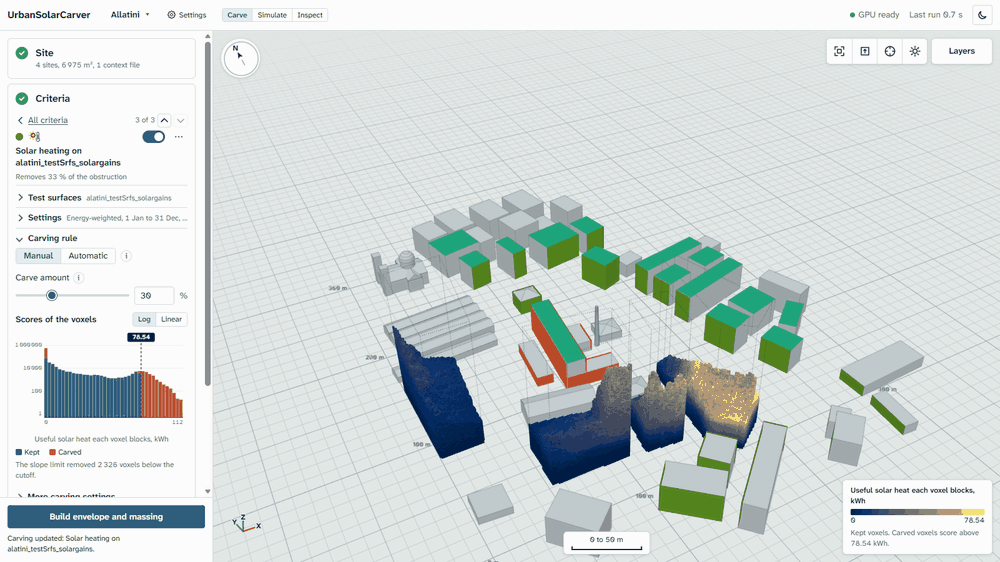
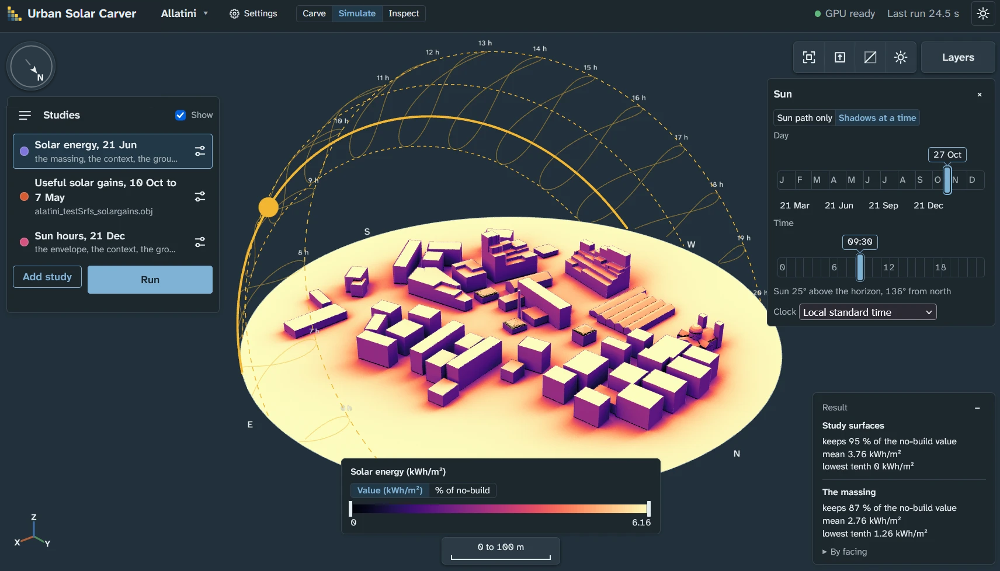
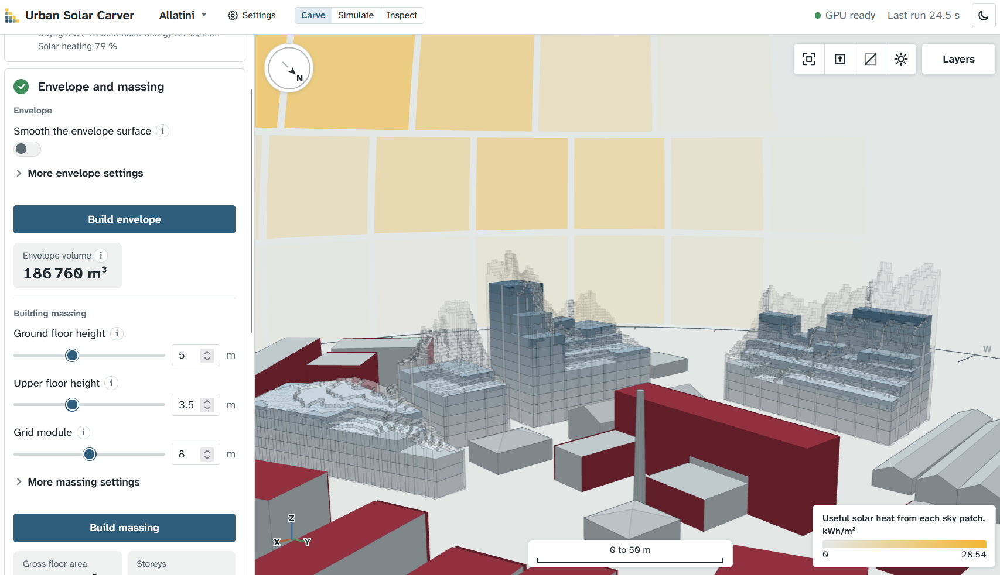

#  Urban Solar Carver

[](LICENSE)
[](https://doi.org/10.5281/zenodo.19443737)
[](https://doi.org/10.1007/978-3-032-34930-9_70)

Urban Solar Carver is an application for urban design and planning. It finds the shape of the maximum developable volume on
a site that keeps the sunlight, daylight and solar energy of the surrounding buildings. It answers urban form questions such as:
how much extra volume can we build here without harming the neighbours? It is intended for urban designers, planners,
architects and decision makers, and runs locally in a web browser, on an NVIDIA graphics card if one is available or on the
processor.


*The Urban Solar Carver interface.*

## Modes

Each mode protects one aspect of environmental performance:

| Mode | Protects |
|---|---|
| **Sun hours** | Hours of direct sun on windows, facades or open spaces |
| **Daylight** | Diffuse daylight from an overcast sky |
| **Solar heating** | Winter sun that reduces heating demand (passive solar) |
| **Solar energy** | Solar radiation on roofs and facades, for photovoltaics |
| **Angle rule** | A fixed angle from each surface, as in many building codes; no weather data needed |
| **Night cooling** | The clear night sky, for radiative cooling (experimental) |

A project can combine several modes. More are planned, such as outdoor thermal comfort.

## How it works

1. Define the site: a maximum volume, or plots with height limits, and the surrounding buildings.
2. Choose the surfaces to protect: windows, facades, roofs or open spaces.
3. Run the analysis. Each voxel of the volume is scored by how much it obstructs those surfaces, using sun and sky data from
   a weather file.
4. Set how much to remove with a slider and review the resulting envelope.
5. Export the envelope and a building massing with storeys and floor areas.



*Changing the carve amount updates the envelope.*

| Carve | Simulate | Massing |
|---|---|---|
|  |  |  |
| Voxel scores, their histogram and the carve amount | Simulations to check a design: sun hours, solar energy or daylight on the surroundings and the new volume, compared with an empty site | Storeys that follow the envelope, with floor areas |

## Install (Windows)

1. Download the repository as a zip (**Code > Download ZIP**) and extract it to any folder you can write to. Avoid OneDrive
   folders.
2. Run `setup-urbansolarcarver.bat`. It downloads Python and the required packages into that folder and checks each file
   against a known hash. Python, git and administrator rights are not needed. An install with CUDA needs about 7 GB of disk
   space.
3. Start the application with `start-urbansolarcarver.bat`.

To uninstall, delete the folder. The [installation guide](https://avarth.github.io/UrbanSolarCarver/getting-started/installation/)
lists every download and covers Linux, macOS and installing from source.

## For developers

The engine is a Python library with a command-line interface and YAML configuration. Ray tracing runs on the GPU with NVIDIA
Warp, with a CPU fallback. The [documentation](https://avarth.github.io/UrbanSolarCarver/) covers the
[quick start](https://avarth.github.io/UrbanSolarCarver/getting-started/quick-start/),
[configuration](https://avarth.github.io/UrbanSolarCarver/getting-started/configuration/),
[modes](https://avarth.github.io/UrbanSolarCarver/modes/) and the API. Tutorial notebooks are in [`examples/`](examples/).
The [Grasshopper plugin](https://avarth.github.io/UrbanSolarCarver/grasshopper/) for Rhino still works; it will be replaced by a
live link between Rhino and the application.

## Citation

If you use USC, please cite the paper:

> Vartholomaios, A. (2026). Urban Solar Carver: A GPU-Accelerated Framework for Solar-Driven Urban Form Finding. In: Bragança, L., Tsikaloudaki, K., Giarma, C., Mateus, R., Kontoleon, K., Askar, R., Salles, A. & Cervantes, C. (Eds.), *ReShaping the Built Environment through Sustainability and Circularity: Proceedings of ReSBE 2026 International Conference, Volume 1*. Lecture Notes in Civil Engineering, vol. 905. Springer, pp. 600-607. https://doi.org/10.1007/978-3-032-34930-9_70

```bibtex
@inproceedings{vartholomaios2026usc,
  author    = {Vartholomaios, Aristotelis},
  title     = {Urban Solar Carver: A GPU-Accelerated Framework for Solar-Driven Urban Form Finding},
  booktitle = {ReShaping the Built Environment through Sustainability and Circularity: Proceedings of ReSBE 2026 International Conference, Volume 1},
  editor    = {Bragan{\c{c}}a, Lu{\'i}s and Tsikaloudaki, Katerina and Giarma, Christina and Mateus, Ricardo and Kontoleon, Karolos and Askar, Rand and Salles, Adriana and Cervantes, Camila},
  series    = {Lecture Notes in Civil Engineering},
  volume    = {905},
  pages     = {600--607},
  publisher = {Springer},
  year      = {2026},
  doi       = {10.1007/978-3-032-34930-9_70}
}
```

The paper is open access. A copy is in [`docs/publications/`](docs/publications/Vartholomaios_2026_ReSBE_Urban_Solar_Carver.pdf); it is licensed under [CC BY-NC-ND 4.0](https://creativecommons.org/licenses/by-nc-nd/4.0/), not under the AGPL-3.0 that covers the code. To cite the software itself, use the [Zenodo DOI](https://doi.org/10.5281/zenodo.19443737). See [`CITATION.cff`](CITATION.cff) for machine-readable metadata.

## Built With

[PyTorch](https://pytorch.org/) · [NVIDIA Warp](https://github.com/NVIDIA/warp) · [Ladybug Tools](https://www.ladybug.tools/) · [Trimesh](https://trimesh.org/) · [Shapely](https://shapely.readthedocs.io/) · [scikit-image](https://scikit-image.org/)

## AI-Assisted Development

This tool was developed with AI assistance (OpenAI ChatGPT 4.1, and Anthropic Claude Opus 4.6 to 5.5 and Sonnet 4.6). The author designed the architecture and planned all features; AI tools were used to draft code diffs, code cleanup and implementation. All AI-generated code was reviewed by the author before inclusion. The author takes full responsibility for the correctness, design, and scientific validity of the code.

The scientific methodology, analysis modes, and validation are entirely the author's work. AI tools were not used in the formulation of the research approach or interpretation of results.

## License

[AGPL-3.0](LICENSE). This software is provided as-is with no warranty. See [LICENSE](LICENSE) for details. For commercial licensing inquiries, contact the author.

## Author

[Aristotelis Vartholomaios](https://orcid.org/0000-0001-6177-1130), Department of Planning and Regional Development, University of Thessaly, Volos, Greece. Contact: avartholomaios@uth.gr
